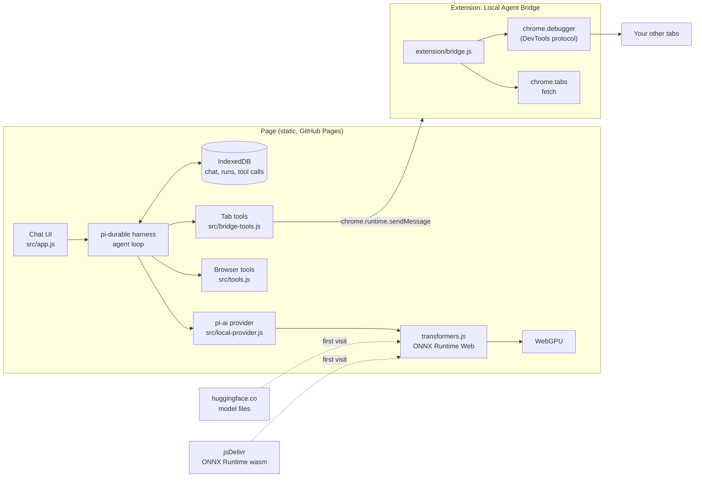

# Local Agent

An AI agent that runs entirely in your browser. Qwen3.5-4B answers on your graphics card through WebGPU, every turn is kept in IndexedDB, and an optional Chrome extension lets the agent read and drive your tabs. There is no backend: the site is static files, and what you type is never sent to an AI service.

**Try it: https://dontpanicv.github.io/local-agent/** (Chrome or Edge, with a WebGPU graphics card that supports 16-bit floats)

On the first visit the page walks you through setup:

1. **Check:** WebGPU with `shader-f16`, and room for the model.
2. **Extension (optional):** what it can do and how to load it unpacked.
3. **Model:** its license and source, then a download button with a progress bar. 2.8 GB come straight from Hugging Face and stay in the browser's Cache Storage, so later visits open the chat at once.

## Architecture



**The agent loop is [pi-durable](https://www.npmjs.com/package/@earendil-works/pi-durable).** A message goes into a pi harness backed by IndexedDB. The harness builds the prompt from the system preamble, the tools and the conversation, then asks the model for a reply. If the reply calls tools, it runs them and loops; the run ends when the model answers in plain text or after 30 tool rounds. Every turn and tool result is committed to IndexedDB before it shows, so a reload or a crash resumes the run where it stopped. Near the end of the context window, pi compacts older turns into a summary.

**The model is a pi-ai provider over transformers.js** (`src/local-provider.js`). It runs `onnx-community/Qwen3.5-4B-ONNX-OPT`, text only with 4-bit weights (q4f16), on ONNX Runtime's WebGPU backend, pinned to one Hugging Face revision.
- **Chunked prefill:** the prompt goes through in 512-token chunks, because one pass over more than about 11,585 tokens overflows ONNX Runtime's WebGPU attention.
- **Context window:** 32K tokens. 60K worked, but every step reprocesses the whole prompt at about 500 tokens/s (15K: 20 s, 30K: 55 s, 60K: 159 s).
- **Tool calls:** Qwen writes them as `<tool_call>` blocks, and `src/parse.js` turns them into pi tool calls.
- **Generation settings:** thinking is off for speed, and sampling follows Qwen's recommended settings.

**Tools in the page** (`src/tools.js`) use browser APIs only:
- time and time zone (`Intl`)
- location (Geolocation)
- device and battery (`navigator`, Battery, WebGPU adapter)
- storage (`navigator.storage`)
- notifications
- clipboard

**Tab and web tools** (`src/bridge-tools.js`) need the extension:
- `list_tabs`, `open_tab`, `read_tab` and `close_tab`
- `fetch_url`
- `web_search`, which reads Bing's results page
- browser use in the style of Vercel's agent-browser:
  - `snapshot_tab` turns a tab's accessibility tree into lines of text and usable elements, each with a ref, like `- button "Sign in" [ref=e42]`. Divs styled as clickable, such as list rows, get refs too (`src/snapshot.js`).
  - `click`, `fill`, `press_key`, `scroll`, `navigate` and `go_back` act on a ref, wait until the page stops changing, then report what changed: a new page in full, or the lines that appeared and went away. When nothing changed, they say so.

**The tools keep track of state so the small model doesn't have to:**
- They work in one tab unless told otherwise.
- They accept only refs from that tab's latest snapshot, or an element's name.
- They refuse to touch the chat's own tab.
- Tabs the agent opens stay behind the chat.
- A call that keeps coming out the same is flagged the second time and refused after that.
- When the final answer tells the user to click or open something the agent could reach itself, a pi `onYield` hook sends it back to do it, and the chat shows a note.

**The extension is a thin bridge** (`extension/bridge.js`). It runs a fixed list of commands, only for pages that its manifest's `externally_connectable` lists: this site and localhost. It controls tabs through `chrome.debugger`, so input events are real. While attached, Chrome shows a "started debugging this browser" bar; the extension detaches after a minute idle. The `key` in the manifest fixes the extension ID (`pfalegngbacegjcckgmgfiffjkndhdbo`), which `src/bridge-tools.js` expects.

**Onboarding** (`src/onboarding.js`) runs until the model has loaded once in this browser, then sets a flag in `localStorage`. After that the page loads the model from Cache Storage. If the browser evicted it, the page downloads it again.

## Privacy and safety

- The model, the chat and the agent loop stay in your browser. The first visit fetches the page from GitHub Pages, the model from Hugging Face and the ONNX Runtime wasm from jsDelivr. After that, the only requests are the pages and searches the agent makes for you.
- With the extension, the agent can control any tab, including sites you are signed in to, and text on a page can steer it. Watch it on sites that matter, and remove the extension when you don't need it.
- A 4B model makes mistakes. Check its answers, and anything it says it did.

## Development

```bash
npm install
npm start          # builds public/ and serves http://localhost:8787/
npm test           # tool-call parser and snapshot self-checks
npm run eval:tools # every tool against fake sites, without the model (about 1 minute)
npm run eval:agent # the real agent on 25 tasks (about 30 minutes); add words to pick some: -- linkedin
```

`npm run build` (`build.mjs`) writes the bundle `public/app.js`, `public/licenses.txt` with the license of every package bundled into it, and `public/local-agent-bridge.zip`. The GitHub Actions workflow in `.github/workflows/pages.yml` runs the tests and the build, then publishes `public/` to GitHub Pages on every push to `main`.

On localhost the page first looks for the model under `models/<model id>/` and falls back to Hugging Face. To skip the download, for example for the evals, put the repo's files there, at least the config and tokenizer files and `onnx/*_q4f16.onnx*`. For a local build, load `extension/` unpacked from `chrome://extensions`. To host the site anywhere other than this GitHub Pages address, add its origin to `externally_connectable` in `extension/manifest.json`.

### Evals

`evals/` starts a throwaway Chrome profile with the extension. It sends `www.linkedin.com`, `github.com` and `shop.test` to local fake sites in `evals/fixtures.mjs`, so the tasks use real URLs without touching real accounts. The fakes copy what tripped the agent up on the real sites:
- rows built from clickable divs
- checkboxes drawn by their labels
- content drawn after the page loads
- a dialog over the page
- a notifications badge that lures it away from messages

The two runners:
- `tools.mjs` checks each tool directly (43 checks).
- `agent.mjs` gives the real agent 25 tasks: ones people tried, one for each tool, and a few that combine tools. It checks both the fake sites' state and the answer.

Results go to `evals/results/`. The evals need Chrome at its usual path (or set `CHROME=...`), plus the internet for `web_search`. In the last runs, all 43 tool checks passed and the agent passed 22 to 23 of the 25 tasks. The tasks it fails sometimes are the multi-step ones: accepting every invitation, using a shop's search box, and going back after opening an issue.

## Files

| Path | What it is |
|---|---|
| `src/app.js` | harness setup, system preamble, chat UI |
| `src/onboarding.js` | first-visit checks, extension step, model download |
| `src/local-provider.js` | pi-ai provider over transformers.js, chunked prefill |
| `src/parse.js` | `<tool_call>` parser, hand-back detection |
| `src/tools.js` | browser API tools |
| `src/bridge-tools.js` | tab, web and browser-use tools, loop guards |
| `src/snapshot.js` | accessibility tree → snapshot with refs |
| `extension/` | the Chrome extension (Manifest V3) |
| `public/index.html` | the page and its styles |
| `build.mjs` | static build, license file, extension zip |
| `server.mjs` | local static server for development and evals |
| `evals/` | fake sites, tool checks, agent tasks |

## Licenses

This project is under the [MIT License](LICENSE).

The model, [Qwen3.5-4B](https://huggingface.co/Qwen/Qwen3.5-4B), is released by the Qwen team under the [Apache License 2.0](https://huggingface.co/Qwen/Qwen3.5-4B/blob/main/LICENSE). The ONNX conversion is by [onnx-community](https://huggingface.co/onnx-community/Qwen3.5-4B-ONNX-OPT). This repository and site don't redistribute the model: your browser downloads it from Hugging Face, under the [Hugging Face terms of service](https://huggingface.co/terms-of-service).

The packages bundled into the site are listed with their license texts in `licenses.txt`, which the build generates. They are:
- `@earendil-works/pi-*` (MIT)
- `@huggingface/transformers` (Apache-2.0)
- `onnxruntime-web` and `onnxruntime-common` (MIT)
- `partial-json` (MIT)

`web_search` reads Bing's public results page from your browser; use it within Bing's terms.
